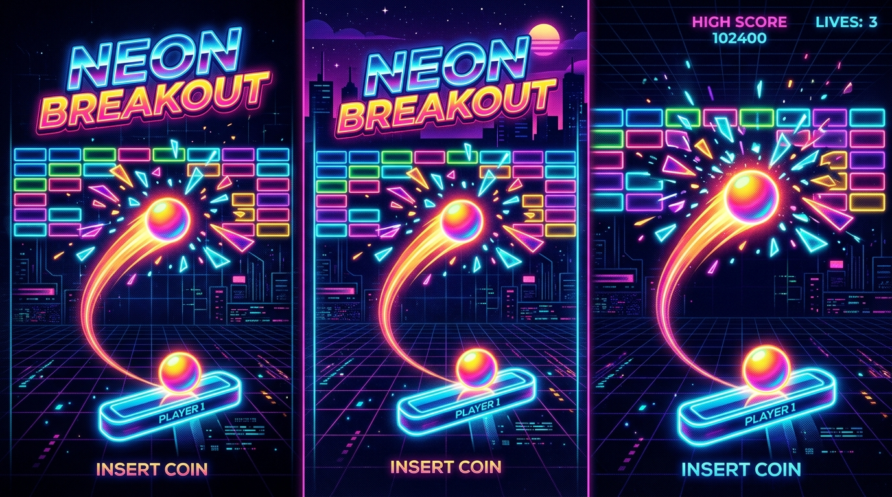

# 🕹️ Breakout Infinito

[](https://github.com/leonardoconstantino/breakout-infinito/actions/workflows/deploy.yml)
[](https://react.dev/)
[](https://www.typescriptlang.org/)
[](https://vitejs.dev/)
[](https://tailwindcss.com/)
[](https://developer.mozilla.org/pt-BR/docs/Web/API/Canvas_API)
[](LICENSE)

> Um jogo arcade de sobrevivência sem fim baseado no clássico Breakout / Arkanoid, reimaginado com estética neon synthwave, física precisa em 60 FPS, ondas procedurais dinâmicas, combos multiplicadores e power-ups eletrizantes.

---

### 🚀 **[Jogar Agora (Produção)](https://leonardoconstantino.github.io/breakout-infinito/)**

---

<p align="center">
  
</p>

---

## 🌟 Principais Recursos

- ♾️ **Progressão Sem Fim por Ondas**: Enfrente padrões dinâmicos (Grade Clássica, Tabuleiro de Xadrez, Pirâmide e Fortaleza Blindada) com dificuldade e velocidade escalonadas.
- 🧱 **Diversidade Tática de Blocos**:
  - **Normais**: Blocos coloridos de pontuação progressiva por linha.
  - **Blindados (Armored)**: Blocos de liga metálica que requerem 3 impactos e exibem fissuras dinâmicas.
  - **Explosivos (Explosive)**: Detonam em cadeia ao sofrer dano, aniquilando blocos vizinhos com ondas de choque.
  - **Indestrutíveis**: Barreiras de aço que forçam jogadas estratégicas de rebote e desvio.
- ⚡ **Sistema Dinâmico de Power-Ups**:
  - 📏 **Raquete Ampla**: Expande a largura da raquete em 40% temporariamente.
  - 🔻 **Raquete Encolhida**: Reduz a largura da raquete, exigindo precisão cirúrgica.
  - 🔮 **Multibolas (Multi-Ball)**: Triplica as bolas ativas simultaneamente em jogo.
  - 🧲 **Raquete Magnética (Sticky Paddle)**: Segura a bola ao tocar na raquete para mira controlada.
  - ☄️ **Bola de Fogo (Fireball)**: Atravessa e destrói blocos instantaneamente sem ricochetear.
  - 🐢 **Bola Lenta**: Reduz o ritmo caótico para recalibrar a trajetória.
  - ❤️ **Vida Extra**: Restaura 1 vida para estender sua corrida.
  - 🔫 **Canhões Laser**: Dispare projéteis verticais para abrir caminho na muralha de blocos.
- 🔥 **Multiplicador de Combos & Notas**: Acumule impactos consecutivos sem derrubar a bola para atingir multiplicadores de até **3.0x** e receber notas de desempenho (**S**, **A**, **B**, **C**).
- 🏆 **Placar de Líderes Local (Hall da Fama)**: Registre seu apelido retro de até 6 caracteres e guarde seus 10 maiores recordes e estatísticas de carreira.
- 🔊 **Engine de Áudio Procedural (Web Audio API)**: Efeitos sonoros sintetizados nativamente no navegador, sem dependência de arquivos externos pesados.
- 📱 **100% Responsivo & Multi-Plataforma**: Jogue no PC ou dispositivos móveis com suporte a mouse, teclado e touch deslizante.

---

## 🎮 Controles

| Dispositivo / Entrada | Ação | Descrição |
| :--- | :--- | :--- |
| **Mouse / Touch** | Mover Raquete | Arraste o cursor ou deslize o dedo na tela para mover a raquete lateralmente. |
| **Clique / Toque** | Lançar Bola | Libera a bola presa na raquete no início da partida ou com o power-up magnético. |
| **Setas / `A` / `D`** | Mover Raquete | Controle clássico pelo teclado. |
| **`Espaço`** | Lançar Bola / Atirar | Libera a bola presa ou dispara os canhões laser quando equipados. |
| **`P` ou Botão de Pausa** | Pausar Jogo | Pausa e congela a partida sem perder seu progresso. |

---

## 🛠️ Tecnologias Utilizadas

- **Framework**: [React 19](https://react.dev/)
- **Linguagem**: [TypeScript 5.8](https://www.typescriptlang.org/)
- **Bundler & Build Tool**: [Vite 6.2](https://vitejs.dev/)
- **Estilização**: [Tailwind CSS 4.0](https://tailwindcss.com/)
- **Ícones**: [Lucide React](https://lucide.dev/)
- **Animações de UI**: [Motion (Framer Motion)](https://motion.dev/)
- **Renderização**: [HTML5 Canvas 2D API](https://developer.mozilla.org/pt-BR/docs/Web/API/Canvas_API) com double buffering lógico e render loop via `requestAnimationFrame`
- **Áudio**: [Web Audio API](https://developer.mozilla.org/pt-BR/docs/Web/API/Web_Audio_API) com sintetizadores polifônicos em código puro

---

## 💻 Como Rodar Localmente

### Pré-requisitos
- [Node.js](https://nodejs.org/) versão 18 ou superior (Node 20 recomendado).
- Gerenciador de pacotes `npm`, `pnpm` ou `yarn`.

### Passo a passo

1. **Clone o repositório:**
   ```bash
   git clone https://github.com/leonardoconstantino/breakout-infinito.git
   cd breakout-infinito
   ```

2. **Instale as dependências:**
   ```bash
   npm install
   ```

3. **Inicie o servidor de desenvolvimento:**
   ```bash
   npm run dev
   ```
   Acesse a aplicação no navegador em `http://localhost:3000`.

4. **Executar verificação de tipos e lint:**
   ```bash
   npm run lint
   ```

5. **Gerar build de produção local:**
   ```bash
   npm run build
   ```
   Os arquivos finais otimizados serão gerados no diretório `dist/`.

---

## 🚀 Deploy Automático no GitHub Pages

O projeto conta com uma esteira automatizada configurada em [`.github/workflows/deploy.yml`](.github/workflows/deploy.yml).

### Como funciona:
1. A cada **push** nas branches `main` ou `master` (ou acionamento manual via **Workflow Dispatch**):
   - O GitHub Actions inicializa um runner Ubuntu com Node.js 20.
   - Instala as dependências de forma limpa (`npm ci` / `npm install`).
   - Valida a tipagem com `npm run lint`.
   - Gera o bundle de produção via `npm run build` com a variável de ambiente `GITHUB_ACTIONS=true` (garantindo o caminho base correto `/breakout-infinito/`).
   - Publica os artefatos estáticos automaticamente no GitHub Pages.

---

## 📄 Licença

Este projeto está sob a licença [MIT](LICENSE). Sinta-se livre para usar, estudar e aprimorar o código!
